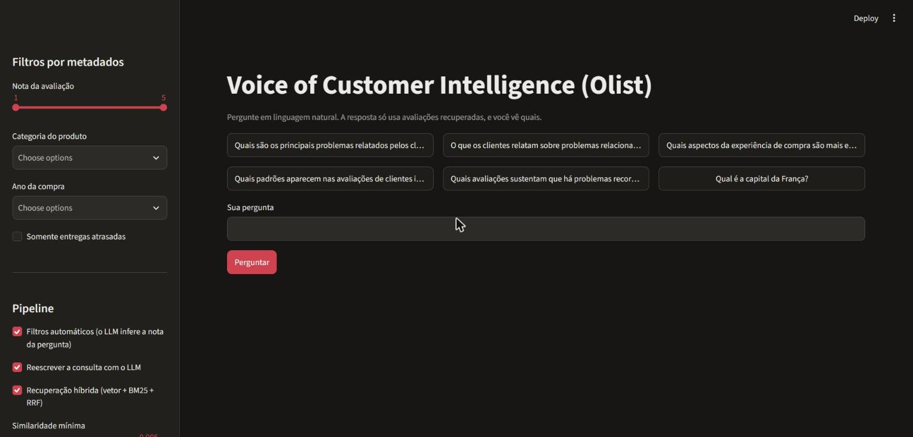
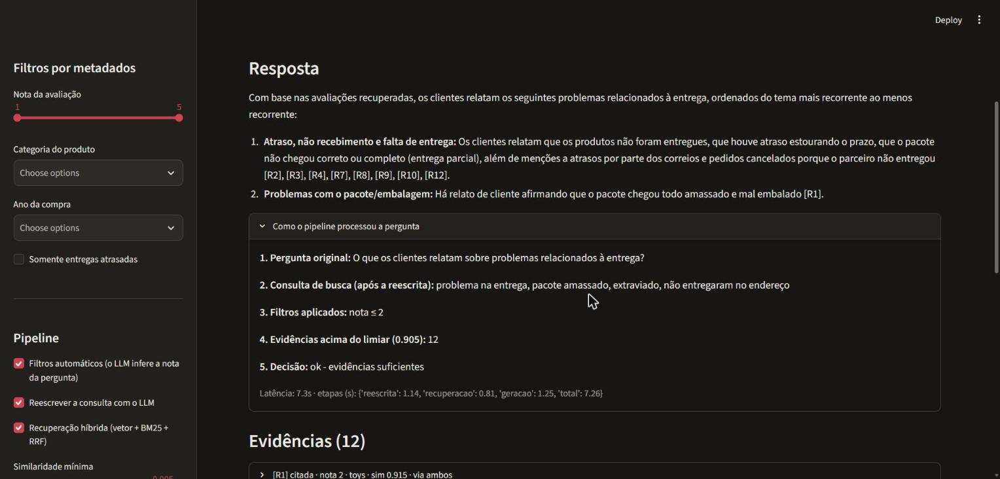
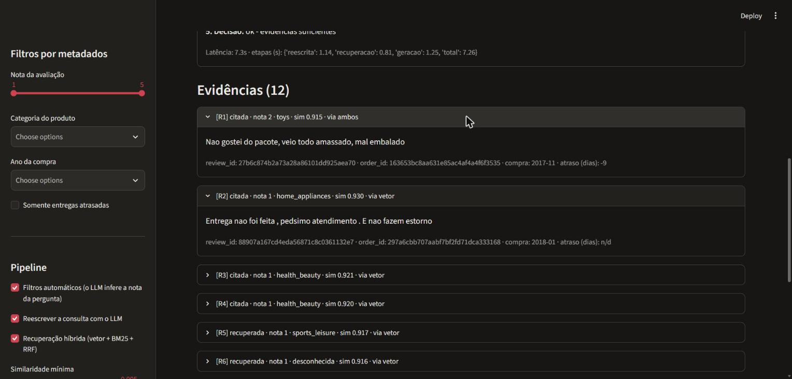
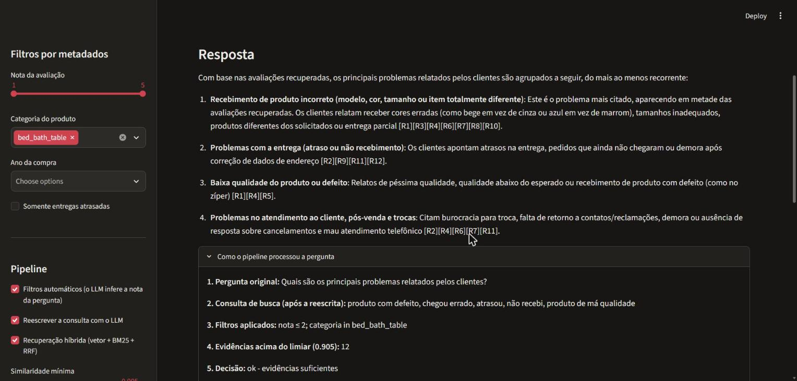
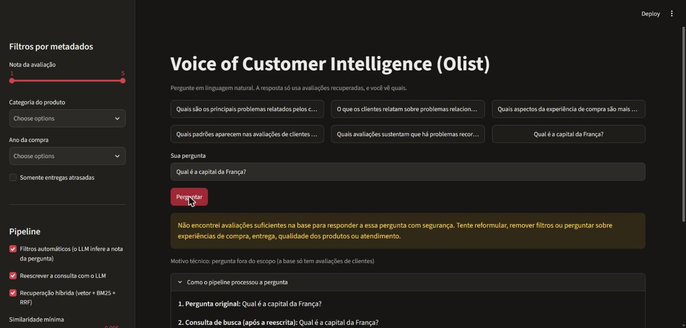

# Voice of Customer Intelligence com RAG (Olist)

Tech Challenge – Fase 4 (Deep Learning and NLP). Gestores fazem perguntas em linguagem natural sobre as avaliações de clientes da Olist e recebem respostas **fundamentadas nas avaliações recuperadas**, com as evidências visíveis. Quando a base não sustenta a resposta, o sistema **recusa** em vez de inventar.

## Arquitetura

```
Pergunta do usuário
   │
   ▼
[1] Reescrita da pergunta (LLM) ──► consulta de busca + filtros inferidos (nota, atraso)
   │                                  (+ filtros manuais da interface: nota, categoria, ano, atraso)
   ▼
[2] Embedding da consulta (multilingual-e5-small, local)
   │
   ▼
[3] Busca vetorial no ChromaDB (HNSW, cosseno) com filtro de metadados  ──► 40 candidatos
   │
   ▼
[4] Seleção: limiar de similaridade + remoção de quase-duplicatas ──► até 12 evidências
   │
   ├── poucas/nenhuma evidência? ──► RECUSA (sem chamar o LLM de geração)
   ▼
[5] Contexto numerado [R1]..[Rn] com nota, categoria e mês
   │
   ▼
[6] Geração (Gemini ou OpenAI) com prompt que exige citações e permite "SEM_EVIDENCIA"
   │
   ▼
Resposta + evidências (citadas destacadas) + trilha de decisão
```

| Camada | Escolha |
|---|---|
| Embeddings | `intfloat/multilingual-e5-small` (local, gratuito, bom em português) |
| Banco vetorial | ChromaDB persistente, índice HNSW, distância cosseno |
| Orquestração | LangChain (LCEL, Pydantic, fallbacks) |
| LLM | Gemini (`gemini-3.5-flash-lite`, padrão) ou OpenAI (`gpt-4o-mini`), via `.env` |
| Interface | Streamlit + CLI |
| Dados | Brazilian E-Commerce Public Dataset by Olist (Kaggle) |

## Como executar

Requisitos: Python 3.10+ e uma chave de API (Gemini tem camada gratuita).

```bash
git clone https://github.com/felps2003/tech-challenge-agent-rag-voice-of-customer.git
cd tech-challenge-agent-rag-voice-of-customer
python -m venv .venv && .venv\Scripts\activate      # Linux/Mac: source .venv/bin/activate
pip install -r requirements.txt

cp .env.example .env        # preencha GEMINI_API_KEY (Windows: copy .env.example .env)
```

1. Baixe o dataset em <https://www.kaggle.com/datasets/olistbr/brazilian-ecommerce/data> e extraia os CSVs em `data/raw/`. Arquivos usados:
   `olist_order_reviews_dataset.csv`, `olist_orders_dataset.csv`, `olist_order_items_dataset.csv`, `olist_products_dataset.csv`, `product_category_name_translation.csv`.
2. Construa a base e o índice:

```bash
python -m src.prepare       # limpa e gera data/processed/reviews_kb.csv
python -m src.index         # embeddings + ChromaDB (~15 min em CPU para os 35 mil documentos)
python -m scripts.calibrate # (opcional) ajuda a escolher MIN_SIMILARITY
```

Para um teste rápido, `python -m src.index --limit 2000` indexa uma amostra em ~1 minuto.

Dois problemas conhecidos de ambiente (Windows):

- **Pasta sincronizada (OneDrive, Dropbox):** o Chroma trava ao gravar o índice dentro dela. Defina `CHROMA_DIR` no `.env` apontando para uma pasta local fora da sincronização, por exemplo `CHROMA_DIR=C:/voc_rag_chroma`.
- **`pyarrow` antigo:** a versão 17 derruba o ChromaDB com "access violation". O `requirements.txt` já exige `pyarrow>=21`.

Na primeira abertura do app, espere ~30 s: ele carrega o modelo de embeddings e o índice BM25 antes de aceitar perguntas.

3. Use:

```bash
streamlit run app.py
python cli.py "O que os clientes relatam sobre problemas de entrega?"
python -m pytest            # testes das funções puras
```

## Preparação da base

| Decisão | Justificativa |
|---|---|
| Só avaliações **com texto** (título ou comentário, ≥ 15 caracteres) | Sem texto não há o que recuperar; "ok"/"bom" não servem de evidência. |
| Título + mensagem num único documento | O título costuma carregar o tema ("Não recomendo"), e a busca precisa vê-lo junto. |
| Limpeza leve (URLs, espaços, letras repetidas "ótimooooo") | Embeddings contextuais entendem acento e caixa. **Sem** remover stopwords nem stemming: isso destruiria contexto que o modelo usa. |
| Remoção de duplicatas exatas de texto | Evita que um mesmo comentário repetido infle a recuperação. |
| Valores ausentes: nunca descartar por metadado faltante | Categoria → `desconhecida`; datas → marcadores (`-1`, `-999`). A avaliação continua útil. |
| Metadados: nota, categoria (traduzida), ano/mês da compra, status, dias de atraso | Permitem filtros e perguntas contextualizadas (Desafio Adicional). |
| Categoria do pedido = a mais frequente entre os itens | Um pedido pode ter vários itens; uma categoria por avaliação mantém o filtro simples. |

Os números de cada etapa (total → com texto → sem duplicatas) são impressos por `python -m src.prepare`.

### Chunking: por que **não** fatiamos

A aula de RAG trata o chunking como decisão central. Aqui cada avaliação já é uma unidade semântica curta (mediana de 11 palavras, 95% com até 34, máximo 48), então **1 avaliação = 1 documento**. Fatiar quebraria o contexto de um comentário que já cabe inteiro no modelo de embeddings, e o `review_id` fica como identidade rastreável da evidência. A "granularidade" é controlada por título+mensagem juntos e pelo corte mínimo de 15 caracteres.

### Privacidade (LGPD)

Seguindo a aula de ética: avaliações são texto livre e podem conter dados pessoais. `prepare.py` mascara e-mail, CPF e telefone (`[EMAIL]`, `[CPF]`, `[TELEFONE]`) **antes** de indexar e de enviar qualquer trecho ao LLM (minimização). É uma heurística (regex): na base real mascarou 5 documentos, com um falso positivo; não garante anonimização completa. Além disso, o prompt trata o texto das avaliações como **dado, nunca instrução** (proteção contra prompt injection).

## Estratégia do pipeline RAG

- **Reescrita da pergunta:** a pergunta do gestor ("quais os problemas dos insatisfeitos?") é diferente do que o cliente escreve ("produto chegou quebrado"). O LLM converte para o estilo de comentário e infere filtros (ex.: "insatisfeitos" → nota ≤ 2). Se falhar, usa a pergunta original.
- **Recuperação híbrida:** busca vetorial (sinônimos: "demorou" ≈ "atrasou") + BM25 (termos literais), fundidas por **Reciprocal Rank Fusion** (`1/(60+posição)`), como na aula. O cosseno é calculado para todos os candidatos, inclusive os achados só pelo BM25, porque é ele que decide a recusa. Dá para desligar o híbrido na interface e comparar.
- **Filtro de metadados dentro da busca:** aplicado na própria busca vetorial (e no BM25), não depois, para não perder resultados relevantes.
- **Seleção:** corte por similaridade mínima, remoção de quase-duplicatas e limite de 12 evidências, para o contexto ser enxuto e variado.
- **Geração fundamentada:** o prompt proíbe conhecimento externo, exige citação `[R#]` por afirmação e manda falar "nas avaliações recuperadas" (o LLM vê uma amostra, não a base inteira, então não pode afirmar percentuais globais).
- **Rastreabilidade:** a interface lista todas as evidências, marca quais foram citadas e mostra o contexto exato enviado ao LLM.

## Metadados: como contribuem para a recuperação (desafio adicional)

O embedding captura o **tema** do texto, mas não a nota, a categoria do produto nem se a entrega atrasou de fato. Esses dados ficam como metadados e viram filtros aplicados **dentro** da busca (cláusula `where` do Chroma e máscara equivalente no BM25). Medi o efeito na base completa, só com a busca vetorial e sem LLM (`python -m scripts.metadados`):

| Situação | Sem filtro | Com filtro |
|---|---|---|
| Reclamações em geral (12 primeiros) | 83% eram de nota ≤ 2 (2 eram nota 5) | 100% |
| Categoria `bed_bath_table` (40 primeiros) | 4 de 40 eram da categoria | 12 de 12 |
| "Problema de entrega" (40 primeiros) | só 13 haviam chegado atrasadas (24 no prazo, 3 sem data) | 12 de 12 atrasadas |
| Elogios (12 primeiros) | 100% com nota ≥ 4 | 100% (sem ganho) |

Leitura: os filtros permitem **perguntas que a busca semântica sozinha não consegue responder** ("nas avaliações de baixa nota", "na categoria X", "nas entregas que de fato atrasaram"), porque o texto não carrega essa informação. O ganho é grande para categoria e atraso, pequeno para nota baixa e nulo para elogios (o texto já separa bem). Dois cuidados: o filtro garante a propriedade por construção, então o que importa é a pergunta realmente pedi-la; e os filtros automáticos inferidos pelo LLM podem errar (aparecem no painel do pipeline e podem ser desligados ou sobrescritos na barra lateral).

## Perguntas sem evidência suficiente

Duas barreiras independentes:

1. **Determinística (antes do LLM):** se menos de `MIN_EVIDENCES` (3) avaliações passam de `MIN_SIMILARITY`, o sistema recusa e nem chama o gerador. Isso cobre perguntas fora do escopo ("capital da França") e filtros que não retornam nada.
2. **Pelo LLM:** o prompt manda responder `SEM_EVIDENCIA` se o contexto não responde à pergunta.

`python -m scripts.calibrate` imprime a similaridade do melhor resultado para perguntas dentro e fora do escopo e sugere um limiar. Na base completa, as perguntas do domínio ficaram em **0,926 ou mais** e as de fora em **0,885 ou menos**, então o limiar padrão é **0,905** (ponto médio). Se trocar o modelo de embeddings, recalibre. Há um detalhe importante: a reescrita da pergunta marca `fora_do_escopo` para que uma pergunta sem relação com e-commerce não vire uma consulta "genérica" que passaria do limiar (o teste mostrou esse problema com "capital da França").

## Avaliação

`python -m scripts.evaluate` (use `--judge` para fidelidade e `--no-llm` para não gastar API) mede, com um conjunto dourado pequeno de 10 perguntas (7 no escopo, 3 fora):

- **Precision@12 da recuperação**, comparando só-vetor vs. híbrido. "Relevante" = a avaliação contém termo-chave do tema (proxy declarado, sem rótulo humano).
- **Acerto de recusa:** responde o que deve e recusa o que está fora do escopo.
- **Taxa de respostas com citação**, **latência** por etapa e, com `--judge`, **fidelidade** (afirmações sustentadas ÷ afirmações, via LLM-as-a-judge).

Resultado de uma execução real (`gemini-3.5-flash-lite`, base completa):

| Métrica | Resultado |
|---|---|
| Precision@12, só vetor | 0,65 |
| Precision@12, híbrido BM25 + vetor (RRF) | 0,64 |
| Acerto de recusa (7 perguntas respondidas, 3 recusadas) | 100% |
| Respostas com citação | 100% |
| Fidelidade (LLM-as-a-judge) | 100% |
| Latência média por pergunta | 4,2 s |

Leitura honesta: **o híbrido não melhorou a precisão neste teste** (0,64 vs 0,65, diferença desprezível). Os comentários são curtos e o vetor já captura bem o tema; o BM25 fica como opção ligada por padrão, mas o ganho não foi demonstrado. A fidelidade de 100% é medida por outro LLM em só 7 respostas, então é um indicativo, não uma garantia. Limitação geral: conjunto de 10 perguntas e "relevante" definido por palavra-chave.

## LangChain (modelo das aulas)

O pipeline segue o que foi visto nas aulas de LangChain, em `src/rag.py`:

- **LCEL com `|`:** `prompt | llm | StrOutputParser()` na geração (aula 01) e `RunnableLambda` / `RunnablePassthrough.assign` / `RunnableBranch` para ligar os passos (aula 02). O `RunnableBranch` decide entre recusar e gerar.
- **Saída estruturada:** a reescrita da pergunta usa `with_structured_output` com um modelo Pydantic (`ConsultaReescrita`); se o LLM devolver nota inválida, o Pydantic barra e entra o fallback.
- **Fallbacks:** `.with_fallbacks()` na reescrita (cai na pergunta original) e entre provedores (Gemini principal, OpenAI reserva, se houver as duas chaves).
- **Vector store:** `langchain_chroma.Chroma` com embeddings E5 embrulhados em `Embeddings` do LangChain (`src/embeddings.py`).
- A recuperação híbrida (BM25 + vetor + RRF) é lógica própria dentro de um `RunnableLambda`, porque precisei manter o cosseno de cada candidato para decidir a recusa, o que o `EnsembleRetriever` pronto não expõe.

## Justificativa das principais decisões

- **Embeddings locais:** custo zero, sem limite de requisições para ~40 mil documentos, reprodutível sem chave. O E5 multilíngue cobre português; exige os prefixos `query:`/`passage:`, implementados em `src/embeddings.py`.
- **ChromaDB:** persistente em disco, suporta filtro por metadados nativamente, sem servidor.
- **Cosseno com vetores normalizados:** a similaridade vira `1 - distância`, fácil de interpretar e usar como limiar.
- **Recusa antes do LLM:** barato, determinístico e auditável; não depende do modelo "se comportar".

## O app em funcionamento

Capturas reais do Streamlit (`streamlit run app.py`), com a base completa de 35.210 avaliações e o modelo `gemini-3.5-flash-lite`.

**1. Tela inicial:** filtros por metadados na barra lateral, opções do pipeline e perguntas de exemplo.



**2. Resposta e trilha do pipeline:** a resposta vem agrupada por temas, com citações `[R#]`. O painel mostra a pergunta original, a consulta reescrita, os filtros aplicados, quantas evidências passaram do limiar e o tempo de cada etapa.



**3. Evidências rastreáveis:** cada evidência indica se foi citada, a nota, a categoria, a similaridade e quem a achou (vetor, BM25 ou ambos). Ao abrir, aparecem o texto original, o `review_id`, o `order_id`, o mês da compra e o atraso na entrega.



**4. Filtro por metadados:** com a categoria `bed_bath_table` marcada, a busca fica restrita a essa categoria (aqui combinada com o filtro de nota ≤ 2 inferido pela pergunta).



**5. Recusa:** uma pergunta fora do escopo ("capital da França") não gera resposta inventada. O sistema avisa e mostra o motivo técnico, sem listar evidências.



## Exemplos de perguntas e respostas

Saídas reais do sistema (modelo `gemini-3.5-flash-lite`, 35.210 avaliações indexadas). As evidências listadas são as primeiras citadas; a interface mostra todas, com `review_id` e `order_id` para rastrear a avaliação original. Observação: no exemplo 1 a reescrita aplicou sozinha os filtros "nota ≤ 2" e "entrega atrasada", que aparecem no painel do pipeline e podem ser desligados na barra lateral.

### Exemplo 1: O que os clientes relatam sobre problemas de entrega?

- Consulta de busca (após reescrita): `problema na entrega, o pedido atrasou, transportadora, não chegou`
- Filtros: nota <= 2; entrega atrasada
- Decisão: **ok** (evidências suficientes); latência 48.0s

**Resposta:**

> Com base nas avaliações recuperadas, os clientes relatam os seguintes temas sobre problemas de entrega, ordenados do mais para o menos recorrente:
> 
> 1. **Não recebimento / Produto não entregue:** Os clientes relatam que o produto não chegou, não foi entregue pela transportadora/correios ou que houve problemas que impediram a realização da entrega [R1][R2][R3][R4][R7][R8][R12]. Alguns mencionam problemas específicos com a transportadora ou exigem reembolso [R2][R3][R7][R8].
> 2. **Atraso na entrega:** Os clientes apontam atrasos, expiração ou esgotamento do prazo estipulado sem que o produto fosse entregue [R5][R6][R9][R10][R11]. Também são citados a falta de contato, justificativa ou resposta por parte da empresa sobre o ocorrido [R5].

**Evidências mais citadas:**

- [R1] nota 1, sim 0.921, review `3bd4d54b…`: "Houve algum problema na entrega e o produto não chegou."
- [R2] nota 1, sim 0.915, review `327d75c4…`: "O produto não foi entregue. Mensagem da transportadora diz que "Objeto ainda não chegou à unidade""
- [R3] nota 1, sim 0.919, review `1e3ff31a…`: "O produto não veio. Peço verificar junto a empresa e transportadora, pois até o momento meu pedido não foi entregue. Contando com o apoio dos senhores."

### Exemplo 2: O que os clientes mais elogiam?

- Consulta de busca (após reescrita): `recomendo, ótimo produto, gostei muito, chegou rápido, excelente atendimento`
- Filtros: nota >= 4
- Decisão: **ok** (evidências suficientes); latência 3.5s

**Resposta:**

> Com base nas avaliações recuperadas, os clientes elogiam os seguintes temas, ordenados do mais ao menos recorrente:
> 
> 1. **Agilidade na entrega (entrega rápida / no prazo):** É o aspecto mais mencionado nas avaliações, citado por 11 clientes [R1][R2][R3][R4][R5][R6][R7][R9][R10][R11][R12].
> 2. **Qualidade do produto (produto excelente / ótimo / conforme anunciado):** É o segundo tema mais recorrente, elogiado por 9 clientes [R1][R3][R4][R5][R7][R9][R11] e mencionado de forma geral ("os produtos") em [R7] e [R10].
> 3. **Atendimento:** Destacado positivamente por 5 clientes [R2][R4][R6][R8][R10].

**Evidências mais citadas:**

- [R1] nota 5, sim 0.950, review `76fe154d…`: "Produto excelente chegou muito rápido recomendo"
- [R2] nota 5, sim 0.944, review `9b1eb5c6…`: "muito bom o atendimento. produto chegou rápido"
- [R3] nota 5, sim 0.961, review `685fdc14…`: "entrega rápida, ótimo produto, recomendo."

### Exemplo 3: Quais são os principais problemas nas avaliações de baixa nota da categoria bed_bath_table?

- Consulta de busca (após reescrita): `produto de má qualidade, tecido rasgou, tamanho errado, costura mal feita, defeito`
- Filtros: nota <= 2; categoria in bed_bath_table
- Decisão: **ok** (evidências suficientes); latência 3.0s

**Resposta:**

> Com base nas avaliações recuperadas da categoria bed_bath_table, os principais problemas são os seguintes, ordenados do mais ao menos recorrente:
> 
> 1. **Qualidade ruim do produto / Material ruim / Má costura**:
>    - Problemas de má qualidade e costuras mal feitas ou erradas foram relatados em [R1], [R2], [R3] e [R4].
> 
> 2. **Envio de produto errado (cor e tamanho incorretos)**:
>    - O recebimento de produtos com cor ou tamanho errados aparece em [R3] e [R5].
> 
> 3. **Problemas de tamanho / Defeito de fabricação**:
>    - O produto apresentar defeito de tamanho (um lado maior que o outro e costuras erradas) foi mencionado em [R2] e [R3].
> 
> 4. **Péssimo atendimento ao cliente**:
>    - Falta de atendimento adequado e funcionária desrespeitosa por telefone foram relatados em [R5].

**Evidências mais citadas:**

- [R1] nota 1, sim 0.914, review `1d3a8ea3…`: "Má qualidade. Fronha de má qualidade, costuras pareciam mal feitas."
- [R2] nota 1, sim 0.919, review `d7ab800f…`: "Produto com defeito de tamanho, um lado maior que o outro e as costuras erradas no tamanho"
- [R3] nota 1, sim 0.914, review `2f2a5e45…`: "Produto errado,cor e tamanho errado, péssima qualidade."

### Exemplo 4: Qual é a capital da França?

- Consulta de busca (após reescrita): `Qual é a capital da França?`
- Filtros: (sem filtros)
- Decisão: **sem_evidencia** (pergunta fora do escopo (a base só tem avaliações de clientes)); latência 0.8s

**Resposta:**

> Não encontrei avaliações suficientes na base para responder a essa pergunta com segurança. Tente reformular, remover filtros ou perguntar sobre experiências de compra, entrega, qualidade dos produtos ou atendimento.

## Limitações conhecidas

- A resposta descreve temas **nas avaliações recuperadas** (top 12), não estatísticas da base inteira. Para contagens/percentuais, o caminho seria um passo de agregação (ex.: classificação de tópicos em todas as avaliações).
- Avaliações ironicamente positivas ("adorei esperar 40 dias") podem ser mal interpretadas pelo embedding.
- O limiar de similaridade depende do modelo de embeddings e precisa de calibração.

## Cota da API e escolha do modelo

No plano gratuito do Gemini, o `gemini-2.5-flash` permite só **20 requisições por dia** e cada pergunta gasta 2 (reescrita + geração); contas novas nem têm acesso aos modelos 2.5. Por isso o padrão é `gemini-3.5-flash-lite` (rápido e disponível). Confira os modelos da sua conta em <https://ai.dev/rate-limit> e ajuste `GEMINI_MODEL` no `.env`. Se uma chamada falhar, a reescrita cai na pergunta original e registra um aviso no log; o provedor reserva (OpenAI) só entra se houver `OPENAI_API_KEY`.

## Estrutura

```
app.py                Interface Streamlit
cli.py                Consulta pelo terminal
src/prepare.py        Construção da base de conhecimento
src/embeddings.py     Embeddings E5 (prefixos query/passage)
src/index.py          Indexação no ChromaDB
src/rag.py            Pipeline RAG (reescrita, busca, seleção, geração)
src/lexical.py        Busca BM25 (parte lexical do híbrido)
src/llm.py            Fábrica do LLM (Gemini/OpenAI) com fallback
scripts/calibrate.py  Calibração do limiar de similaridade
scripts/evaluate.py   Precision@k, recusa, citações, latência, fidelidade
scripts/metadados.py  Efeito dos filtros de metadados na recuperação
tests/                Testes unitários
data/raw/             CSVs da Olist (não versionados)
```
